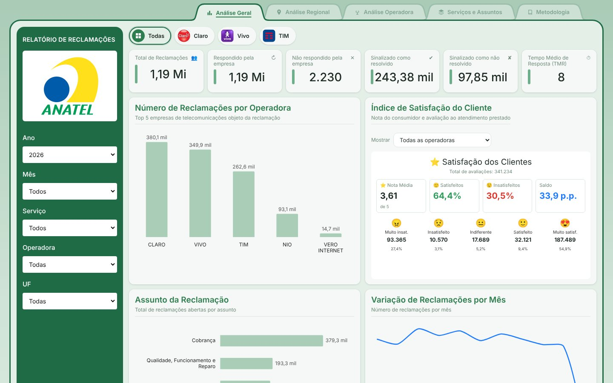
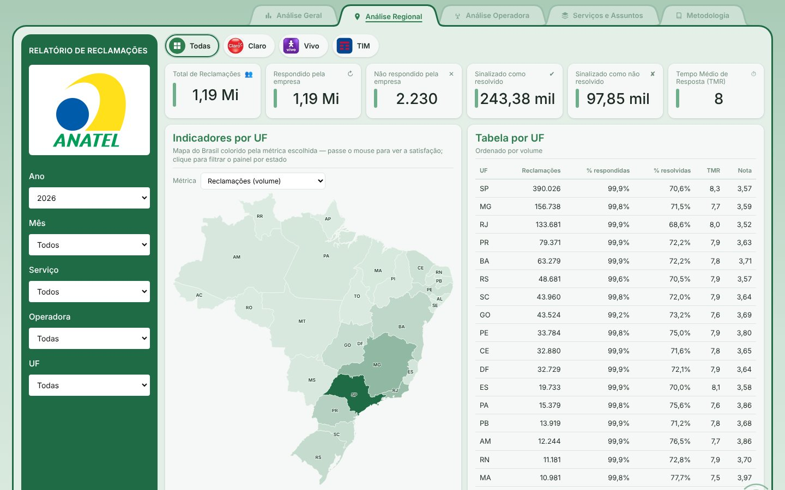
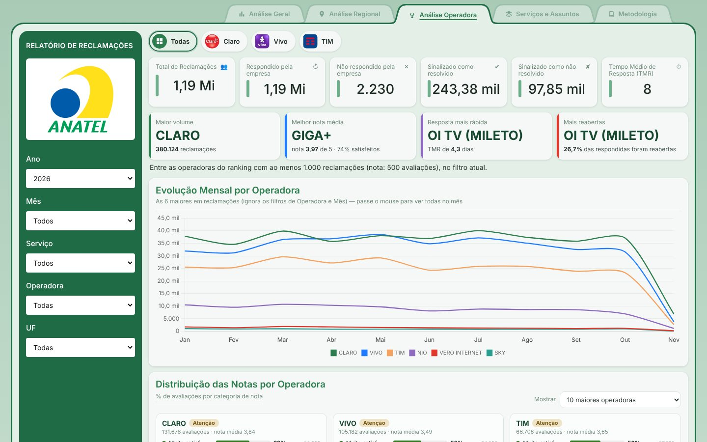
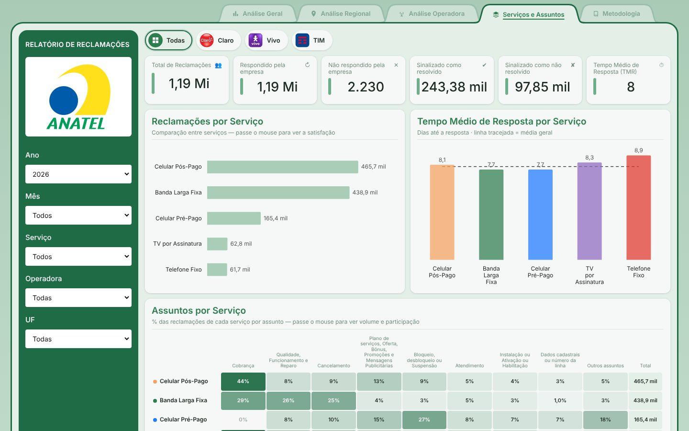
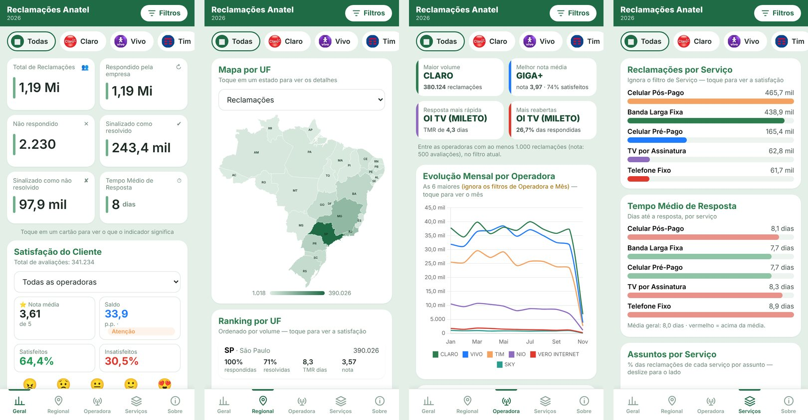
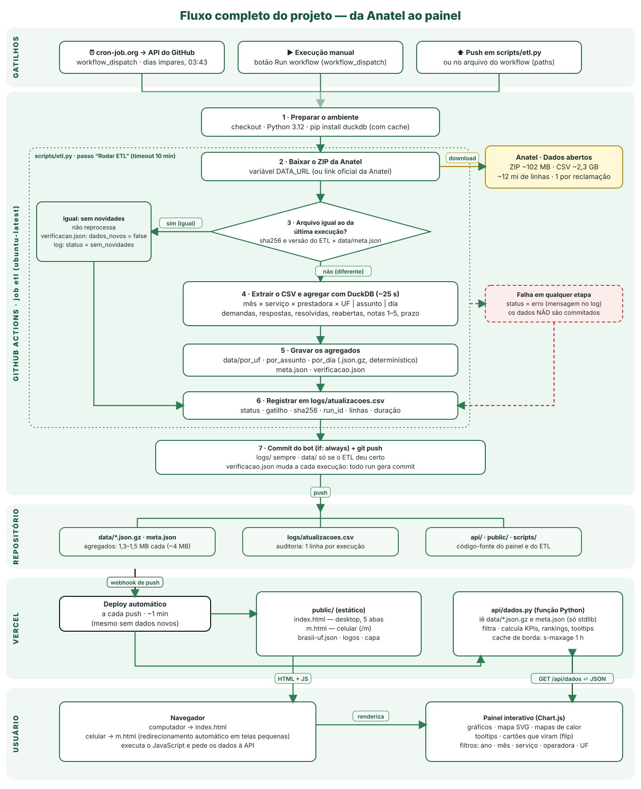

<div align="center">

# 📡 Reclamações Anatel — Dashboard de Qualidade de Atendimento

**Painel interativo dos Indicadores de Qualidade de Atendimento do Anatel Consumidor (telecom),
atualizado sozinho todos os dias, com versão própria para celular.**

[](https://reclamacaoanatel.vercel.app)
[](https://reclamacaoanatel.vercel.app/m.html)
[](https://github.com/RodrigoAiosa/ReclamacaoAnatel/actions/workflows/atualizar-dados.yml)


[**Abrir o painel**](https://reclamacaoanatel.vercel.app) · [Versão para celular](https://reclamacaoanatel.vercel.app/m.html) · [Como funciona](#-como-funciona) · [Rodar localmente](#-rodar-localmente)



</div>

---

## 📌 Sobre o projeto

A Anatel publica, como dados abertos, uma base com **uma linha por reclamação** de consumidores de telecomunicações
(mais de 12 milhões de registros desde nov/2019, um arquivo ZIP de ~2,4 GB). O arquivo é grande demais para abrir em
planilha e, no Power BI, exigiria baixar e atualizar tudo manualmente.

Este projeto automatiza o caminho inteiro, do arquivo bruto até a decisão:

1. **Verifica** todos os dias se a Anatel publicou dados novos;
2. **Agrega** a base em segundos, com DuckDB, para arquivos de poucos megabytes;
3. **Publica** o painel novamente, sem ninguém mexer;
4. **Registra** cada execução em um log auditável.

O resultado é um painel com indicadores de atendimento, satisfação do consumidor, comparação entre operadoras,
mapa por estado e análise de serviços e assuntos, com *tooltips* detalhados.

## ✨ Recursos

| | |
|---|---|
| 📊 **Análise Geral** | Indicadores (reclamações, respondidas, resolvidas, TMR), top operadoras, satisfação do cliente, assuntos e evolução mensal. Os cartões giram e explicam cada indicador. |
| 🗺️ **Análise Regional** | Mapa do Brasil por UF, com métrica selecionável (volume, % respondidas, % resolvidas, nota, % satisfeitos, TMR) e tabela por estado. Clicar em um estado filtra o painel. |
| 📡 **Análise Operadora** | Destaques (maior volume, melhor nota, resposta mais rápida, mais reabertas), evolução mensal das 6 maiores, distribuição das notas e ranking das 20 maiores. |
| 🧩 **Serviços e Assuntos** | Reclamações e TMR por serviço, mapa de calor serviço × assunto, mapa de calor operadora × assunto, reabertas por operadora e volume × satisfação. |
| 📖 **Metodologia** | Glossário, fórmulas com exemplo calculado na hora, níveis de satisfação, fonte e limitações, tudo dentro do painel. |
| 📱 **Versão celular** | Interface própria (`/m`): navegação inferior, filtros em folha, toque no lugar do mouse. Celulares são levados a ela automaticamente. |
| 🔎 **Filtros** | Ano, mês (só os meses que existem nos dados), serviço, operadora (atalhos Claro, Vivo e TIM) e UF. |
| 🔄 **Atualização automática** | Verificação nos dias ímpares do mês, às 03:43 (Brasília), seguindo a rotina de publicação da Anatel. Só reprocessa se o arquivo mudou. |

<details>
<summary><b>Ver mais telas</b></summary>

<br>

| Análise Regional | Análise Operadora |
|---|---|
|  |  |

| Serviços e Assuntos |
|---|
|  |

</details>

### 📱 Versão para celular

<div align="center">

</div>

---

## 🧭 Como funciona

<p align="center">
  
</p>

<sub>Cinco camadas: **gatilhos** → **GitHub Actions** (ETL) → **repositório** → **Vercel** → **usuário**. Os caminhos tracejados em vermelho mostram o que acontece quando o ETL falha: o log é gravado, mas os dados não são commitados.</sub>

**1. Verificação.** O workflow baixa o arquivo e compara o `sha256` com o da última execução. Se for igual, apenas registra
uma linha no log e encerra. A Anatel publica a base em dias ímpares do mês, por isso a verificação segue esse calendário.

**2. ETL.** `scripts/etl.py` lê o CSV direto do ZIP com DuckDB e produz agregados (mês × serviço × prestadora × UF ou assunto
ou dia) com somas e contagens, em arquivos JSON compactados. O resultado é determinístico: o mesmo dado gera os mesmos bytes.

**3. Publicação.** O workflow faz *commit* dos agregados e do log. O push dispara o *deploy* da Vercel, e o painel já sai
com os dados novos.

**4. Consulta.** A função `api/dados.py` (Python puro, sem dependências) recebe os filtros, recalcula indicadores, rankings e
tooltips a partir dos agregados e devolve um único JSON. O front-end desenha tudo com Chart.js.

### 🧾 Log de atualizações

Cada execução (com dados novos ou não) acrescenta uma linha em [`logs/atualizacoes.csv`](logs/atualizacoes.csv):

| Coluna | Conteúdo |
|---|---|
| `data_hora_execucao_utc` · `data_hora_atualizacao_utc` | Quando rodou e quando os dados foram de fato atualizados |
| `status` | `atualizado`, `sem_novidades` ou `erro` |
| `gatilho` | `schedule`, `workflow_dispatch` ou `push` |
| `run_id` · `run_numero` · `run_url` · `commit_sha` | Ligação com a execução e o commit no GitHub |
| `origem_url` · `sha256_zip` · `tamanho_zip_mb` | Identificação do arquivo da Anatel |
| `registros_origem` · `linhas_agregadas` · `periodo_inicio` · `periodo_fim` · `ultima_data_abertura` | O que a base contém |
| `duracao_segundos` · `versao_etl` · `mensagem` | Desempenho, versão do formato e detalhe do resultado |

---

## 📐 Indicadores

| Indicador | Definição |
|---|---|
| **Reclamações** | Demandas com `TIPO_ATENDIMENTO = Reclamação` |
| **% respondidas** | `RESPONDIDA = S` ÷ reclamações |
| **% resolvidas** | Resolvidas ÷ (resolvidas + não resolvidas), só entre as avaliadas pelo consumidor |
| **% reabertas** | Reabertas ÷ respondidas |
| **Nota média** | Média de `NOTA_CONSUMIDOR` (1 a 5) |
| **TMR** | Tempo Médio de Resposta, em dias, só das respondidas |
| **% satisfeitos / insatisfeitos** | Notas 4 e 5 (satisfeitos) ou 1 e 2 (insatisfeitos) ÷ avaliações |
| **Saldo** | % satisfeitos − % insatisfeitos, em pontos percentuais |

**Nível de satisfação:** `Sem dados` (nenhuma avaliação) · `Crítico` (saldo negativo) · `Atenção` (insatisfeitos de 20% ou mais)
· `Excelente` (saldo de 50 p.p. ou mais) · `Bom` (demais casos).

> ⚠️ A base não traz o número de clientes de cada operadora. Os rankings comparam **volume de reclamações**, e operadoras
> maiores tendem a ter mais. Compare também os percentuais.

---

## 🗂️ Estrutura do repositório

```
.
├── api/
│   └── dados.py                 # função serverless (GET /api/dados): filtros, KPIs, rankings, tooltips
├── scripts/
│   ├── etl.py                   # ETL (DuckDB): ZIP da Anatel → data/*.json.gz + log
│   └── servir_local.py          # servidor local (public/ + /api/dados), sem Vercel CLI
├── data/                        # agregados gerados pelo ETL (versionados; é o que a API lê)
│   ├── por_uf.json.gz · por_assunto.json.gz · por_dia.json.gz
│   └── meta.json · verificacao.json
├── logs/
│   └── atualizacoes.csv         # uma linha por execução do workflow
├── public/
│   ├── index.html               # dashboard (computador)
│   ├── m.html                   # dashboard (celular)
│   ├── brasil-uf.json           # contornos dos estados (mapa)
│   └── operadoras/ · capa.jpg · logo-anatel.png
├── docs/img/                    # imagens deste README
├── .github/workflows/
│   └── atualizar-dados.yml      # verificação diária + ETL + commit
├── requirements-etl.txt         # duckdb
└── vercel.json                  # saída estática em public/ e inclusão de data/ na função
```

---

## 🚀 Rodar localmente

**Requisitos:** Python 3.12+ (3.10+ costuma funcionar) e, para o ETL, ~3 GB livres em disco.

```bash
git clone https://github.com/RodrigoAiosa/ReclamacaoAnatel.git
cd ReclamacaoAnatel

# 1) ver o painel com os dados já versionados em data/
python scripts/servir_local.py            # http://localhost:8765  (celular: /m.html)
```

O navegador precisa de internet para carregar o Chart.js da CDN.

```bash
# 2) (opcional) reprocessar a base da Anatel
pip install -r requirements-etl.txt
DATA_URL="https://www.anatel.gov.br/dadosabertos/paineis_de_dados/consumidor/indicadores_qualidade_atendimento.zip" \
  python scripts/etl.py
# ou com um arquivo que você já baixou:
python scripts/etl.py --file caminho/para/arquivo.zip
```

Se o ZIP não mudou desde a última execução (mesmo `sha256`), o ETL sai sem reprocessar. A função da Vercel também roda
com `npx vercel dev`.

## ☁️ Publicar o seu próprio

1. Faça um *fork* ou clone do repositório.
2. Na Vercel: **Add New → Project**, importe o repositório (sem *build command*; *output directory* `public`). O
   `vercel.json` já inclui `data/**` na função.
3. No GitHub, em **Settings → Actions → General**, deixe as permissões de *workflow* como **Read and write**, para o
   robô poder fazer *commit* dos dados.
4. (Opcional) Para apontar para outra URL de origem, crie a variável `DATA_URL` em **Settings → Secrets and variables →
   Actions → Variables**. Sem ela, vale o link oficial da Anatel definido no workflow.
5. Rode o workflow **Atualizar dados (verificação diária)** uma vez, em *Run workflow*, para conferir. Depois disso, ele
   roda sozinho nos dias ímpares do mês, às 06:43 UTC.

> O agendamento do GitHub Actions pode atrasar ou pular execuções em horários de pico. Como cada execução fica no log, é
> fácil conferir pela coluna `gatilho = schedule`.

## 🔌 API

```
GET /api/dados?ano=2026&mes=03&servico=Banda%20Larga%20Fixa&prestadora=CLARO&uf=SP
```

Todos os parâmetros são opcionais. A resposta é um JSON com `meta`, `opcoes` (valores dos filtros), `kpis`, `sat`,
`serie` (mensal), `evolucao_op`, `dias`, `operadoras`, `assuntos`, `regional` e `servicos`. A resposta é armazenada em cache
na borda por 1 hora.

---

## 🛠️ Tecnologias

| Camada | Tecnologia |
|---|---|
| Processamento | Python 3.12 · DuckDB |
| Automação | GitHub Actions (cron + `workflow_dispatch`) |
| API | Função serverless Python na Vercel (somente biblioteca padrão) |
| Front-end | HTML, CSS e JavaScript sem *framework* · Chart.js 4.4 · mapa em SVG |
| Hospedagem | Vercel |

## ⚖️ Dados e licença

Os dados são da **Anatel**, publicados em [dados.gov.br](https://dados.gov.br/dados/conjuntos-dados/consumidor---indicadores-de-qualidade-de-atendimento)
sob a licença **Creative Commons Attribution (CC BY)**. O painel é uma leitura independente desses dados e não é um
produto oficial da Anatel. A Anatel pode corrigir informações depois de publicá-las, e o último mês costuma estar incompleto.

## 👤 Autor

**Rodrigo Aiosa** · [github.com/RodrigoAiosa](https://github.com/RodrigoAiosa)

Sugestões e *issues* são bem-vindas.
